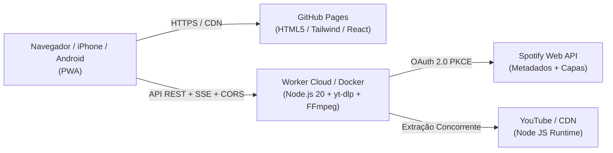

# MusicFlow Downloader 4.0 — Guia de Produção e Hospedagem

Este guia documenta o passo a passo completo para colocar o **MusicFlow Downloader 4.0** em produção pública na internet com custo zero ou mínimo, suportando computadores, iPhones (iOS Safari) e dispositivos Android.

---

## 1. Arquitetura Desacoplada (Frontend no GitHub Pages + Worker Cloud)



- **Frontend**: Hospedado no **GitHub Pages** (100% gratuito, CDN global rápida, SSL automático).
- **Backend Worker**: Hospedado em um container Docker Linux com Node.js 20, Python 3, `yt-dlp` e `ffmpeg`.
- **Comunicação**: O frontend conversa diretamente com a URL pública do Worker via CORS com suporte nativo a Server-Sent Events (SSE) e streaming de downloads.

---

## 2. Passo a Passo — Publicar o Frontend no GitHub Pages

### Passo 2.1: Habilitar o GitHub Pages no Repositório
1. Abra seu repositório no GitHub.
2. Acesse **Settings** > **Pages** (no menu lateral esquerdo).
3. Na seção **Build and deployment** > **Source**, selecione:
   - **GitHub Actions** (em vez de *Deploy from a branch*).

### Passo 2.2: Configurar Secrets no GitHub (Opcional, mas recomendado)
1. No repositório, vá em **Settings** > **Secrets and variables** > **Actions**.
2. Clique em **New repository secret**.
3. Adicione a variável:
   - **Nome:** `NEXT_PUBLIC_WORKER_URL`
   - **Valor:** `https://seu-worker.onrender.com` (a URL HTTPS do seu worker após o deploy da Seção 3).

### Passo 2.3: Disparar o Deploy
- Qualquer `git push` na branch `main` ou `master` acionará automaticamente o workflow `.github/workflows/deploy.yml`.
- O workflow executa testes, checagem de tipos, compilação estática (`npm run build:static`) com geração automática do arquivo `.nojekyll` e publica seu site em:
  `https://<seu-usuario>.github.io/<nome-do-repositorio>/`

---

## 3. Passo a Passo — Hospedagem do Worker Cloud

O Worker executa processamento real de áudio e vídeo com FFmpeg e `yt-dlp`. Por isso, requer um ambiente com suporte a binários do sistema (disponibilizado pelo `Dockerfile` pronto no projeto).

### Opção A — Render.com (Recomendado para início gratuito ou \$7/mês)
1. Crie uma conta gratuita em [render.com](https://render.com).
2. Clique em **New +** > **Web Service**.
3. Conecte seu repositório do GitHub.
4. Escolha a opção **Docker** (o Render detectará automaticamente o `Dockerfile` na raiz).
5. Configure as Variáveis de Ambiente no painel do Render:
   - `PORT`: `4000`
   - `NODE_ENV`: `production`
   - `CORS_ORIGIN`: `https://<seu-usuario>.github.io,*`
   - `FRONTEND_BASE_URL`: `https://<seu-usuario>.github.io/<nome-do-repositorio>`
   - `SPOTIFY_CLIENT_ID`: `c18da041f1b648ed9fdec51b82717160`
   - `SPOTIFY_CLIENT_SECRET`: *(seu segredo do painel Spotify Developer)*
   - `SPOTIFY_REDIRECT_URI`: `https://<nome-do-seu-app>.onrender.com/auth/spotify/callback`
   - `WORKER_API_SECRET`: *(opcional para proteger acessos externos diretos)*
6. Clique em **Create Web Service**.
7. Após o deploy, teste a saúde acessando: `https://<nome-do-seu-app>.onrender.com/ready`.

### Opção B — Railway.app (\$5/mês de créditos)
1. Crie uma conta em [railway.app](https://railway.app).
2. Clique em **New Project** > **Deploy from GitHub repo**.
3. O Railway compilará o `Dockerfile` automaticamente.
4. Em **Settings** > **Networking**, clique em **Generate Domain** para obter a URL pública HTTPS.
5. Em **Variables**, configure as mesmas variáveis descritas na Opção A.

### Opção C — Hetzner Cloud VPS (€3.79 / ~R\$ 22 ao mês — Máxima Performance)
Para downloads de playlists com mais de 500 faixas em segundos com banda ilimitada de 20 TB:
1. Contrate uma instância CPX11 ou CX22 na [hetzner.com](https://www.hetzner.com/cloud).
2. Conecte via SSH e instale o Docker:
   ```bash
   curl -fsSL https://get.docker.com | sh
   ```
3. Clone seu repositório e inicie o container:
   ```bash
   docker build -t musicflow-worker .
   docker run -d \
     --name musicflow-worker \
     --restart unless-stopped \
     -p 4000:4000 \
     --env-file .env \
     musicflow-worker
   ```
4. Aponte um domínio com Nginx/Caddy para gerar SSL Let's Encrypt gratuito.

---

## 4. Configuração do Spotify Developer Dashboard para Produção

Para permitir login permanente de qualquer dispositivo:
1. Acesse o [Spotify Developer Dashboard](https://developer.spotify.com/dashboard).
2. Abra a aplicação correspondente ao Client ID `c18da041f1b648ed9fdec51b82717160`.
3. Clique em **Settings**.
4. Em **Redirect URIs**, adicione:
   - Desenvolvimento local: `http://127.0.0.1:8888/callback`
   - Produção: `https://<sua-url-do-worker>/auth/spotify/callback`
5. Salve as alterações (**Save**).

---

## 5. Persistência de Sessão e Segurança

- **Criptografia AES-256-GCM:** Os tokens de acesso e de atualização do Spotify nunca são salvos em texto puro. O worker utiliza criptografia AES-256-GCM com chave derivada em repouso.
- **Renovação Proativa:** Tokens com validade inferior a 5 minutos são renovados automaticamente em segundo plano antes de expirar.
- **Deduplicação de Requisições de Refresh (Mutex):** Múltiplas requisições paralelas reutilizam a mesma promessa de refresh, impedindo invalidação acidental de tokens rotacionados.
- **Duração de 180 Dias:** O cookie e a chave de sessão local são persistidos por 6 meses (limite máximo permitido pela política oficial do Spotify em 2026).
- **Recuperação Automática:** Caso o usuário feche a aba, desligue a tela do celular ou atualize a página, a sessão permanece ativa imediatamente ao retornar.

---

## 6. Compatibilidade Mobile e iOS Safari

1. **PWA (Progressive Web App):** O site inclui `manifest.json`, ícone de alta resolução e tema escuro `#0a0d14`. No iOS Safari, toque em **Compartilhar** > **Adicionar à Tela de Início** para utilizá-lo como um aplicativo nativo em tela cheia.
2. **Download Nativo no iPhone:** O iOS Safari bloqueia disparos de download automatizados via iframes ocultos. O MusicFlow inclui botões diretos de download (`target="_blank" download`) que acionam a folha de download nativa do sistema iOS, salvando o arquivo diretamente no aplicativo Arquivos / Downloads.
3. **Persistência de Lote ZIP:** Downloads em lote (ex.: 200 faixas) salvam o progresso em `localStorage`. Caso a tela do celular bloqueie momentaneamente durante a conversão, o progresso é restaurado automaticamente assim que o navegador reabre.
